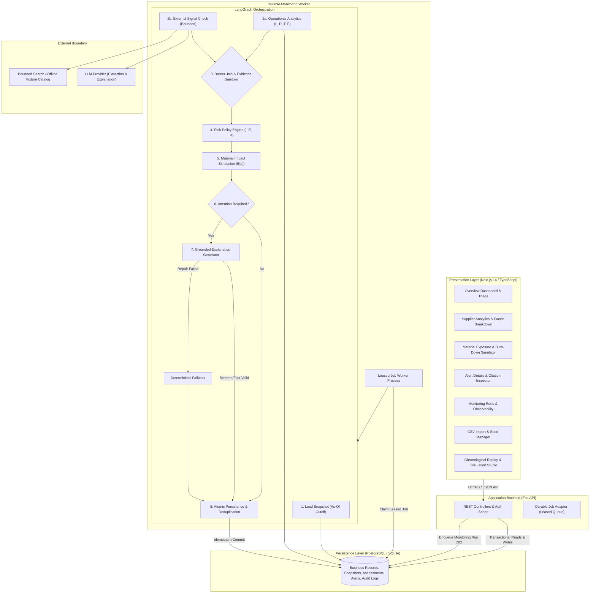

# VendorGuard AI — End-to-End Implementation Plan

**System:** Explainable Supplier Monitoring & Production-Disruption Decision Support for Small Manufacturers  
**Domain Vertical:** Packaging Manufacturing (*Polyethylene Resin, Color Additives, Barrier Film, Corrugated Cartons*)  
**Reference Specification:** *VendorGuard AI Research & System Design Blueprint (37-page Specification)*

---

## 1. Executive Summary & Core Objectives

VendorGuard AI helps purchasing managers and production planners answer three critical operational questions:
1. **Which supplier is showing signs of trouble?** (Internal delivery & fulfillment pattern detection combined with verified public events).
2. **Which materials and production operations could that trouble affect?** (Material inventory, daily consumption rates, and stockout scenarios).
3. **What action can still be taken before inventory becomes insufficient?** (Grounded, citation-backed decision support: expediting, alternate qualified suppliers, safety buffer adjustments).

The system enforces strict boundaries:
- **Separation of Concerns:** 
  1. *Operational Risk Index ($I$)*: Deterministic rule-based metric $[0, 100]$.
  2. *External Evidence Status ($E$)*: Auditable public news/events with explicit status (`reliable_evidence`, `no_relevant_evidence`, `ambiguous_entity`, `unavailable`, `stale`).
  3. *Production Exposure*: Daily inventory simulation ($B[d]$) with explicit coverage days and supply gaps.
  4. *Data Sufficiency*: Explicit sample size tracking and cold-start labeling.
- **Decision Support, Not Divination:** No claims of predicting bankruptcy or converting heuristic scores into uncalibrated failure probabilities.
- **Trust & Security Boundaries:** Untrusted external text is strictly sanitized to prevent prompt injection; LLM never writes directly to scoring weights or executes arbitrary SQL.

---

## 2. System Architecture & Component Design



---

## 3. Mathematical Specifications & Domain Rules

### 3.1 Operational Analytics Engine (Section 8 & 10)
For an evaluation cutoff date $t$, considering purchase order lines due up to $t$:

1. **On-Time Fulfillment Rate**:
   $$\text{on\_time\_fulfillment\_rate} = \frac{\sum [ \text{accepted\_receipts}(l) \ge q \times \text{ordered\_qty}(l) \text{ by due\_date}(l) + \text{grace} ]}{\text{all due lines in 30-day window}}$$
   Where fulfillment fraction $q = 1.0$, grace period $= 0$ days.
2. **Late Fraction ($L$)**:
   $$L = 1 - \text{on\_time\_fulfillment\_rate}$$
3. **Completed Delay ($D$)**:
   $$\text{delay}(l) = \max(0, \text{completion\_time}(l) - \text{committed\_due\_date}(l)) \quad (\text{days})$$
   $$D = \text{clip}\left(\frac{\text{recent mean completed delay}}{10\text{ days}}, 0, 1\right)$$
4. **Trend Deterioration ($T$)**:
   $$T = \text{clip}\left(\frac{\text{recent mean completed delay} - \text{previous mean completed delay}}{5\text{ days}}, 0, 1\right)$$
   *(Compares current 30-day window against prior 30-day window)*
5. **Shortfall ($F$)**:
   $$F = \text{mean}\left(\max\left(0, 1 - \frac{\text{accepted\_quantity\_at\_}t}{\text{ordered\_quantity}}\right)\right) \quad \text{across due lines}$$
6. **Internal Operational Risk Index ($I$)**:
   $$I = 100 \times (0.40L + 0.25D + 0.20T + 0.15F)$$
   *Cold-start policy*: If due lines $< 10$, mark as `limited_history`, renormalize weights across available factors, record excluded terms, and label as `partial`.

### 3.2 External Evidence Scoring (Section 9 & 10)
For each verified public event $j$:
$$e_j = \text{severity}_j \times \text{reliability\_factor}_j \times \text{freshness\_factor}_j \in [0, 1]$$
$$E = 100 \times \max_j(e_j)$$

### 3.3 Blended Risk Index & Override (Section 10)
$$R = \begin{cases} 
\max(I, 0.70I + 0.30E) & \text{if both internal } I \text{ and reliable external } E \text{ exist} \\
I & \text{if external evidence is missing or unverified (labeled \textit{evidence-limited})} \\
\text{withheld} & \text{if only external evidence exists (display } E \text{ independently)}
\end{cases}$$
- **Bands**: `Low` ($< 30$), `Watch` ($30 - 59.99$), `High` ($\ge 60$).
- **Critical-Event Override**: Any verified facility closure or acute disruption triggers an immediate priority override alert, regardless of whether the blended score is dampened.

### 3.4 Production Impact & Daily Inventory Simulation (Section 11)
- **Available Stock**:
  $$\text{available\_stock} = \max(0, \text{on\_hand} - \text{reserved})$$
- **Coverage Days**:
  $$\text{coverage\_days} = \frac{\text{available\_stock}}{\text{expected\_daily\_consumption}}$$
- **Scenario Gap Days**:
  $$\text{scenario\_gap\_days} = \max(0, \text{scenario\_arrival\_lead\_time} - \text{coverage\_days})$$
- **Daily Simulation Trajectory**:
  $$B[d] = B[d-1] + \text{usable\_receipts}[d] - \text{required\_consumption}[d]$$
  *Day to Stockout*: The first day where $B[d] < 0$ under the stress arrival scenario.
- **Alert Prioritization Order**: Lexicographically sorted by:
  1. Shortage Urgency ($\min \text{day to stockout}$)
  2. Material Criticality (Tier 1 > Tier 2 > Tier 3)
  3. Substitution Constraints (Single-source > Multi-source)
  4. Blended Supplier Risk Index ($R$)

---

## 4. Section 12 Worked Example Verification Target

The exact arithmetic declared in **Section 12 of the blueprint** is embedded into the test suite as a strict contract:

```python
# Supplier A Worked Example Contract (Section 12)
L = 0.60
recent_mean_delay = 6.0    # days
prev_mean_delay   = 2.0    # days
F = 0.10

D = 6.0 / 10.0             # = 0.60
T = (6.0 - 2.0) / 5.0      # = 0.80
I = 100 * (0.40 * 0.60 + 0.25 * 0.60 + 0.20 * 0.80 + 0.15 * 0.10)
  # = 100 * (0.24 + 0.15 + 0.16 + 0.015) = 56.5

severity = 0.80; reliability = 0.90; freshness = 1.00
E = 100 * (0.80 * 0.90 * 1.00)  # = 72.0

R = max(56.5, 0.70 * 56.5 + 0.30 * 72.0)
  # = max(56.5, 39.55 + 21.60) = 61.15 (High band: >= 60)

available_resin = 800.0    # kg
daily_consumption = 100.0  # kg/day
coverage_days = 800.0 / 100.0  # = 8 days
scenario_arrival = 12.0    # days from cutoff
scenario_gap = 12.0 - 8.0  # = 4 days supply gap
```

---

## 5. Database Schema & Data Dictionary (Section 7)

All tables include `tenant_id` for multi-tenant isolation, UTC timestamps, and UUID primary keys:

1. `tenants`: `id`, `name`, `created_at`
2. `suppliers`: `id`, `tenant_id`, `legal_name`, `aliases` (JSON), `domain`, `location`, `created_at`
3. `materials`: `id`, `tenant_id`, `name`, `canonical_unit` (kg, m, units), `criticality` (tier_1, tier_2, tier_3)
4. `supplier_materials`: `supplier_id`, `material_id`, `normal_lead_time_days`, `is_approved`, `capacity_known`
5. `purchase_order_lines`: `id`, `tenant_id`, `supplier_id`, `material_id`, `po_number`, `line_number`, `ordered_quantity`, `created_at`, `committed_due_date`
6. `order_line_versions`: `id`, `po_line_id`, `committed_due_date`, `ordered_quantity`, `valid_from`, `recorded_at`
7. `receipts`: `id`, `po_line_id`, `accepted_quantity`, `rejected_quantity`, `received_at`, `recorded_at`
8. `inventory_snapshots`: `id`, `tenant_id`, `material_id`, `warehouse`, `on_hand_quantity`, `reserved_quantity`, `observed_at`, `recorded_at`
9. `demand_forecasts`: `id`, `tenant_id`, `material_id`, `date`, `daily_quantity`, `forecast_as_of`
10. `monitoring_runs`: `id`, `tenant_id`, `as_of`, `status` (pending, leased, running, completed, failed), `lease_expires_at`, `attempt_count`, `idempotency_key`
11. `evidence_items`: `id`, `source_url`, `publisher`, `published_at`, `fetched_at`, `event_type`, `entity_match`, `severity`, `reliability_factor`, `freshness_factor`, `supporting_excerpt`, `is_synthetic`
12. `assessments`: `id`, `tenant_id`, `supplier_id`, `run_id`, `as_of`, `policy_version`, `features` (JSON), `index_score`, `band`, `impact_summary` (JSON), `created_at`
13. `assessment_evidence`: `assessment_id`, `evidence_id`, `inclusion_reason`
14. `alerts`: `id`, `tenant_id`, `assessment_id`, `incident_key`, `severity`, `status` (open, acknowledged, resolved, dismissed), `grounded_explanation` (JSON), `created_at`
15. `alert_feedback`: `id`, `alert_id`, `reviewer_id`, `disposition` (useful, false_alarm, unhelpful), `reason`, `created_at`

---

## 6. LangGraph State & Hybrid Agentic Flow (Section 6 & 11)

### State Schema (`SupplierRiskState`)
```python
class SupplierRiskState(TypedDict):
    tenant_id: str
    supplier_id: str
    run_id: str
    as_of: str
    snapshot_id: str
    policy_version: str
    internal_result: dict      # L, D, T, F, counts, reason_codes, sufficiency
    external_result: dict      # evidence items, status, max_event_score
    score_result: dict         # I, E, R, band, factor_contributions, override_flag
    impact_result: dict        # coverage_days, scenario_gap, trajectory, priority_rank
    explanation_result: dict   # summary, drivers, citations, suggested_actions
    errors: list[str]          # sanitized non-fatal node exceptions
```

### Graph Nodes & Failure Behaviors
- **`load_snapshot`**: Immutable slice of historical orders, receipts, inventory up to `as_of`. Missing supplier fails gracefully for this node only.
- **`operational_analysis`**: Calculates $L, D, T, F$ deterministically. Cold-start threshold (< 10 lines) marks `limited_history`.
- **`external_check`**: Queries bounded search adapter or labeled offline fixtures. Classifies status into `reliable_evidence`, `no_relevant_evidence`, `ambiguous_entity`, `unavailable`.
- **`validate_join`**: Barrier edge ensuring both operational and external nodes complete. Sanitizes untrusted text excerpts.
- **`score_policy`**: Deterministic formula evaluation. Implements floor rule $R = \max(I, 0.7I + 0.3E)$.
- **`impact_analysis`**: Daily burn simulation $B[d]$ over a 30-day horizon under normal and stress delay scenarios.
- **`explain`**: Formats grounded prompt with strict Pydantic JSON schema constraints. One bounded repair retry; deterministic fallback template if model fails.
- **`validate_persist`**: Idempotent database commit of `assessments` and deduplicated `alerts`.

---

## 7. Research Replay & Evaluation Protocol (Section 15)

The evaluation suite (`research/replay/`) backtests warning performance without future leakage:
1. **Baselines**:
   - `B0`: Simple Overdue Rule (Flags overdue purchase order lines).
   - `B1`: Internal-Only Rule Policy ($I$ alone).
   - `B2`: External-Only Signal Policy ($E$ alone).
   - `P1`: Combined Policy ($R = \max(I, 0.7I + 0.3E)$).
   - `P2`: Impact-Aware Prioritization (P1 + $B[d]$ shortage gap urgency).
2. **Metrics Measured**:
   - **Alert-Episode Precision**: $\frac{\text{True Warning Episodes}}{\text{Total Warning Episodes}}$
   - **Incident Recall**: $\frac{\text{Disruptions with Prior Warning}}{\text{All Disruption Incidents}}$
   - **Warning Lead Time**: $\Delta t = \text{Incident Onset} - \text{First Qualifying Prior Alert}$ (in days)
   - **False-Alert Burden**: False alert episodes per supplier-month.
   - **Actionable Recall**: Incidents warned $\ge 5$ days prior to stockout.

---

## 8. Web Interface Screens (Section 13)

Built using Next.js 14, TailwindCSS, and Lucide icons:
1. **Overview Dashboard**:
   - KPI metrics: Suppliers Monitored, Critical Shortages, High-Risk Alerts, Evidence Freshness.
   - **"Run Monitoring"** trigger with live progress bar and status polling.
   - Supplier triage cards and sortable priority table.
2. **Supplier Detail View**:
   - Delivery performance trends over 12 months.
   - Factor contribution breakdown ($L, D, T, F, I, E, R$).
   - Interactive order lines table with delivery latency metrics.
   - External evidence feed with verified excerpt cards.
3. **Material Exposure & Inventory Simulator**:
   - Interactive burn-down chart visualizing $B[d]$ over 30 days under Base vs Delay scenarios.
   - Days-of-coverage badges and projected stockout markers.
   - Alternate supplier table with lead times and qualification status.
4. **Alert Review & Action Triage Modal**:
   - Grounded explanation text with citation chips.
   - Action buttons: *Acknowledge*, *Expedite*, *Switch to Alternative*, *Dismiss*.
   - Reviewer feedback recording.
5. **Monitoring Runs & Observability**:
   - Job history, LangGraph node-level execution traces, step latencies, error states.
6. **Data Import & Dataset Manager**:
   - CSV upload wizard with schema preview and row error validation.
   - Dataset switcher: **Mode A (15 Synthetic Packaging Suppliers)**, **Mode B (Stress Testbed)**, or Custom CSV.
7. **Research Replay Studio**:
   - Replay runner comparing B0..P2, Precision-Recall curves, and lead-time distributions.

---

## 9. Phased Execution Roadmap

- **Phase 1: Foundation & Domain Math**: Workspace setup, Python venv, exact Section 12 test verification.
- **Phase 2: Data Models & Synthetic Datasets**: SQLAlchemy schema, CSV ingestion service, Mode A 15-supplier packaging dataset.
- **Phase 3: LangGraph Assessment Workflow & Durable Worker**: Graph nodes, barrier join, bounded evidence, LLM explanation + template fallback, job queue.
- **Phase 4: FastAPI REST API & Evaluation Harness**: Endpoints (202 async jobs, suppliers, alerts, feedback), replay harness (B0..P2).
- **Phase 5: Next.js Frontend Development**: 7 interactive screens, charts, dark/light styling, API client integration.
- **Phase 6: End-to-End Testing & Verification**: Unit tests, integration tests, full browser verification.
